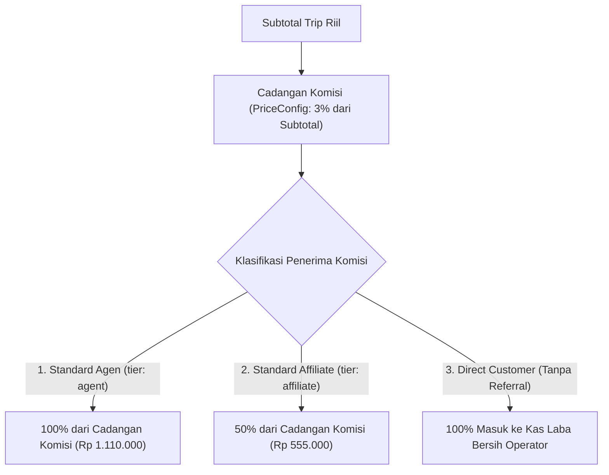
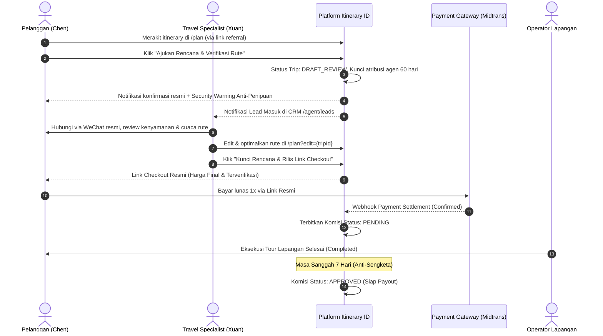

# PRD — Tata Kelola Agen & Afiliasi, Validasi Rute (Approval Gate), dan Mitigasi Risiko Fraud

**Dokumen:** Product Requirement Document (PRD) Tambahan  
**Kode File:** `docs/PRD-Agent-Affiliate-Governance-Risk.md`  
**Status:** Draf Diskusi Manajemen Risiko & Rencana Pembaruan Sistem  
**Dokumen Pendukung:** `docs/PRD-Itinerary-ID.md` (v1.1), `docs/PRD-Affiliate-Pipeline.md` (v1.0)  
**Tanggal:** 28 Oktober 2026  

---

## 1. Eksekutif Ringkasan

Dokumen ini disusun sebagai kelanjutan dari implementasi Pipeline Afiliasi (PRD v1.0). Dokumen ini merangkum:
1. **Struktur Komisi Agen & Afiliasi**: Logika pembagian komisi berjenjang dari pool Biaya Platform tanpa mengurangi margin dasar perusahaan.
2. **Penyelesaian Masalah Penyesuaian Rute Lapangan**: Penerapan mekanisme *Approval Gate / Pre-Payment Validation* agar rute kustom yang disusun turis divalidasi terlebih dahulu oleh Travel Specialist (misal: Agen Xuan di China) sebelum gerbang pembayaran dibuka. Hal ini mencegah selisih biaya per kilometer pasca-pembayaran.
3. **Analisis & Mitigasi Risiko Fraud Agen (*Platform Leakage / Disintermediation*)**: Strategi komprehensif untuk mencegah agen nakal mengirimkan nomor rekening pribadi (WeChat Pay/Alipay/Bank pribadi) atau mengalihkan pesanan ke operator luar.

---

## 2. Struktur Komisi & Model Tingkat Mitra

### 2.1 Filosofi "Satu Kolam Cadangan Komisi" (PRD §5.2 & §5.6)
Komisi agen dan afiliasi **TIDAK diambil dari biaya operasional riil** (armada, hotel, tiket wisata, guide) dan **TIDAK mengorbankan margin target perusahaan**. Seluruh komisi didanai dari satu komponen harga resmi bernama **Biaya Platform (Platform Fee)**.

#### Formula Penetapan Harga:
$$\text{Subtotal} = \text{Transport} + \text{Hotel} + \text{Tiket} + \text{Makan} + \text{Guide}$$
$$\text{MarginTarget} = \text{Subtotal} \times \text{marginTargetRate} \quad (\text{Default: } 2\%)$$
$$\mathbf{CadanganKomisi} = \mathbf{Subtotal \times commissionReserveRate} \quad \mathbf{(Default: } \mathbf{3\%}\mathbf{)}$$
$$\text{Total Harga} = \frac{\text{Subtotal} + \text{MarginTarget} + \text{CadanganKomisi}}{1 - \text{gatewayRate}} \quad (\text{Gateway Midtrans: } 2.5\%)$$
$$\text{Biaya Platform} = \text{Total Harga} - \text{Subtotal} = \text{MarginTarget} + \text{CadanganKomisi} + \text{Biaya Gateway}$$

---

### 2.2 Tiga Level Pengaturan Komisi

| Tingkatan | Konfigurasi Sistem | Hak & Peran Operasional | Rasio Komisi (`payoutShare`) |
| :--- | :--- | :--- | :--- |
| **1. Default Tier (Pax Level)** | Dikelola di `PriceConfig` (`commission_reserve_1_2`, `3_5`, `6_12`). | Menentukan volume uang tunai yang dicadangkan ke dalam pool komisi untuk tiap rentang jumlah peserta. | Pool dasar: **3% dari Subtotal** untuk semua kapasitas (1–12 Pax). |
| **2. Standard Agen (`tier: "agent"`)** | Ditetapkan via `rule-agent-100`. | **Mitra Operasional Aktif**: Mengelola CRM Kanban, konsultasi chat WeChat/WhatsApp, input lead manual, merancang trip di builder (`/plan?lead=...`), dan memantau pesanan. | **100% dari Cadangan Komisi** (karena agen bekerja penuh dari awal hingga closing). |
| **3. Standard Afiliasi (`tier: "affiliate"`)** | Ditetapkan via `rule-affiliate-50`. | **Promotor Konten Murni**: Menyematkan link referral di media sosial (Douyin, Xiaohongshu, Instagram, TikTok). Dashboard bersifat *read-only*. | **50% dari Cadangan Komisi** (sisa 50% dikembalikan ke Operator / dibagikan ke handling agent yang mem-follow-up). |

---

## 3. Masalah Operasional Lapangan & Solusi Approval Gate

### 3.1 Identifikasi Masalah: Dilema E2E Instant Booking vs Penyesuaian Rute
* **Kondisi Awal**: Pelanggan dapat merakit trip secara bebas di builder `/plan` lalu langsung menyelesaikan pembayaran (E2E) melalui Midtrans.
* **Fakta Lapangan Jawa Timur**:
  * Wisata Bromo memerlukan pengaturan Jeep midnight dan titik kumpul khusus.
  * Kawah Ijen memiliki jam pendakian dini hari (blue fire) serta jadwal penutupan berkala untuk konservasi.
  * Jalanan pegunungan berkelok dan sempit memiliki batas kelayakan jenis kendaraan (Avanza vs Hiace).
  * Sistem kita memberlakukan **biaya armada berbasis tarif jarak riil per kilometer ($Rp/km$)**.
* **Dampak Negatif Jika Langsung Dibayar**:
  * Ketika Xuan (Agen) menghubungi pelanggan via WeChat dan menyadari rute pilihan pelanggan tidak realistis, Xuan harus mengubah rute (misal: mengganti hotel, mengubah urutan hari, atau menambah titik singgah).
  * Perubahan rute mengubah jarak tempuh ($KM$) $\rightarrow$ mengubah `transportCost` $\rightarrow$ mengubah total tagihan.
  * Menagih kekurangan bayar atau mengembalikan kelebihan bayar pasca-transaksi akan **merusak reputasi profesionalisme platform dan menurunkan rasa percaya pelanggan**.

---

### 3.2 Solusi Terpilih: "Approval Gate / Konsultasikan & Kunci Rencana" (Solusi 1)

Untuk pesanan yang berasal dari kanal Agen/Afiliasi (atau trip kustom penuh), tombol bayar langsung digantikan oleh alur verifikasi spesialis:

---

## 4. Analisis Risiko & Mitigasi Fraud Agen (*Platform Leakage*)

### 4.1 Bentuk Potensi Fraud yang Dikhawatirkan
1. **Pengalihan Rekening Pribadi**: Agen Xuan mem-follow-up pelanggan di WeChat, lalu meminta transfer langsung ke rekening pribadi Xuan (WeChat Pay / Alipay / Bank pribadi), memotong link Midtrans resmi.
2. **Pengalihan Operator (Side-stepping)**: Agen Xuan mengambil data rencana perjalanan dari platform Itinerary ID, lalu menjualnya ke biro travel independen lain di Jawa Timur.
3. **Penyembunyian Transaksi (Ghosting Lead)**: Agen menandai lead sebagai `lost` (*"pelanggan batal berangkat"*), padahal diam-diam mengeksekusi trip secara ilegal.

---

### 4.2 Matriks 4 Lapis Perlindungan (*Anti-Disintermediation Framework*)

```mermaid
graph TD
    subgraph "Lapis 1: Sistem & Komunikasi"
    L1A["Email/WA Notifikasi Otomatis ke Customer"] --> L1B["Security Warning Anti-Transfer Pribadi"]
    end
    subgraph "Lapis 2: Value & Kepercayaan Pelanggan"
    L2A["Travel Voucher Resmi Imigrasi"] --> L2B["Jaminan Asuransi & Refund 48 Jam"]
    L2B --> L2C["Dukungan Pembayaran WeChat Pay Resmi"]
    end
    subgraph "Lapis 3: Hambatan Ekonomi & Operasional"
    L3A["Monopoli Rantai Pasok Armada Sendiri"] --> L3B["Sanksi Sitaan Saldo Komisi Berjalan"]
    end
    subgraph "Lapis 4: Audit & QA CRM"
    L4A["Wajib Alasan untuk Status Lost"] --> L4B["Sampling Survey CS ke Lead Batal"]
    end
```

#### LAPIS 1: Direct Touchpoint & Peringatan Keamanan Otomatis ke Pelanggan
* Saat pelanggan mengajukan rencana di website, sistem **secara otomatis mengirim pesan konfirmasi resmi berkop Itinerary ID ke email dan kontak pelanggan**:
  > *"Terima kasih Chen! Rencana trip Anda (#TRP-8821) telah diterima. Spesialis resmi Anda adalah **Xuan (ID Lisensi: #AGT-009)**."*
* **Security Notice Wajib (Bahasa Mandarin & Inggris)**:
  > ⚠️ **PEMBERITAHUAN KEAMANAN PEMBAYARAN RESMI:**  
  > *"Itinerary ID **HANYA** menerima transaksi melalui link checkout pembayaran resmi berenkripsi (`https://itinerary.id/checkout/...`). Agen kami **TIDAK PERNAH diizinkan** meminta transfer ke rekening bank pribadi, Alipay perorangan, atau WeChat Pay perorangan. Pembayaran di luar link resmi tidak terlindungi asuransi perjalanan kecelakaan, jaminan penggantian armada, serta membatalkan seluruh hak refund."*
* **Hasil**: Pelanggan teredukasi sejak menit pertama. Pelanggan akan langsung menolak jika agen mencoba meminta transfer pribadi.

#### LAPIS 2: E-Voucher Resmi Imigrasi & Metode Bayar Lokal China
1. **Kebutuhan Dokumen Resmi Turis Asing**:
   * Turis asal China memerlukan lembar konfirmasi perjalanan resmi (*Official Booking Confirmation Voucher*) bertanda tangan perusahaan dan nomor registrasi pariwisata Indonesia untuk pemeriksaan imigrasi serta klaim asuransi visa.
   * Dokumen ini **hanya dapat diterbitkan otomatis oleh sistem setelah pembayaran link Midtrans terkonfirmasi lunas**.
2. **Dukungan Pembayaran Lokal (WeChat Pay / UnionPay)**:
   * Seringkali agen tergoda meminta transfer pribadi karena turis China enggan menggunakan kartu kredit Visa/Mastercard yang mengenakan selisih kurs tinggi.
   * Dengan menyediakan kanal **WeChat Pay / QRIS Internasional / UnionPay** langsung di halaman checkout Midtrans, turis dapat membayar semudah transfer lokal tanpa dalih teknis.

#### LAPIS 3: Hambatan Pasokan Lapangan (*Supply Chain Moat*) & Sanksi Finansial
1. **Ketergantungan Operasional**:
   * Agen Xuan berada di China dan tidak memiliki legalitas operasional, izin armada wisata, maupun relasi langsung dengan driver tangguh Bromo/Ijen di Jawa Timur.
   * Jika Xuan "main belakang", Xuan menanggung risiko 100% jika driver lokal pihak ketiga mogok, wanprestasi, atau mengalami kecelakaan. Risiko hukum di China akan membebankan tuntutan penuh kepada Xuan pribadi.
2. **Klausul Hangus Saldo Komisi (*Commission Forfeiture*)**:
   * Pada Perjanjian Agen Elektronik (`Agent.agreementAcceptedAt`):
   * Agen yang terbukti mengalihkan transaksi (*disintermediation*) akan dikenakan:
     * Penutupan akun permanen (`status = "terminated"`).
     * **Penyitaan 100% saldo komisi berjalan** yang belum dicairkan (*pending/approved payouts* dari trip pelanggan lain).
   * Nilai denda finansial ini jauh lebih tinggi dibanding keuntungan sesaat dari satu trip.

#### LAPIS 4: Audit CRM & Quality Assurance Sampling atas Lead Batal
* Jika agen menandai lead pelanggan sebagai `lost` (*"Pelanggan tidak merespons"* atau *"Pelanggan membatalkan rencana"*):
  * Agen wajib mengisi keterangan rinci di `LeadActivity`.
  * Tim Quality Assurance / CS Operator secara berkala menjalankan **audit sampling pesan ke pelanggan**:
    > *"Halo Chen, kami melihat rencana perjalanan Anda belum diselesaikan. Apakah ada masukan mengenai pelayanan Travel Specialist kami (Xuan)?"*
  * Jika Chen menjawab: *"Lho, saya sudah transfer lunas ke WeChat Xuan kemarin!"* $\rightarrow$ **Fraud langsung terdeteksi seketika**, pesanan dihentikan sebelum berangkat, dan agen ditindak tegas.

---

## 5. Simulasi Skenario Riil (End-to-End)

| Aktor | Identitas | Peran |
| :--- | :--- | :--- |
| **Operator** | Itinerary ID (Surabaya/Malang) | Pengelola legalitas, armada kendaraan, hotel, pemegang rekening resmi Midtrans. |
| **Xuan** | Agen Mitra Resmi (Shanghai Silk Road Travel) | Travel Consultant di China, memegang hak tier `agent`. |
| **Ming** | Afiliasi (Influencer Media Sosial) | Pembuat konten video perjalanan di Douyin/Xiaohongshu, memegang hak tier `affiliate`. |
| **Chen** | Wisatawan (Customer asal Shanghai) | Memesan Paket Private Custom 4 Pax senilai **Rp 40.000.000**. |

### Rincian Alur Keuangan & Pembayaran:
1. **Chen melihat video Douyin Ming**, mengklik link `https://itinerary.id/?ref=MING-DOUYIN`. Sistem merekam atribusi referral Ming selama 30 hari.
2. Chen merancang paket 4 Pax di website $\rightarrow$ Menekan **"Ajukan Rencana & Verifikasi Rute"**.
3. Sistem mengunci Chen ke Ming (sebagai sumber referral) dan menugaskan Xuan (sebagai agen penanganan China). Chen menerima email resmi peringatan anti-transfer pribadi.
4. Xuan mem-follow-up Chen via WeChat, menyempurnakan hotel Sukapura Bromo dan urutan rute via mode `/plan?edit=...`.
5. Rincian Biaya Akhir Terkunci:
   * Subtotal Operasional Riil: **Rp 37.000.000**
   * Cadangan Komisi Pool (3%): **Rp 1.110.000**
   * Margin Target Bersih Operator (2%): **Rp 740.000**
   * Biaya Payment Gateway (2.5%): **Rp 1.025.641**
   * **Total Ditagihkan ke Chen**: **Rp 40.000.000**
6. Chen menerima link checkout resmi dan membayar **Rp 40.000.000 via Midtrans**. Dana 100% masuk ke rekening Operator. E-Voucher perjalanan resmi terbit otomatis.
7. Komisi diterbitkan dalam status `pending`:
   * **Ming (Affiliate)**: 50% dari cadangan komisi = **Rp 555.000**
   * **Xuan (Handling Agent)**: 50% dari cadangan komisi = **Rp 555.000**
8. Operator mengeksekusi trip Chen di lapangan hingga tuntas $\rightarrow$ Status trip disetel ke `completed`.
9. Setelah masa sanggah 7 hari tanpa sengketa, komisi otomatis menjadi `approved`.
10. Pada siklus pembayaran bulanan, tim Finance mencairkan dana komisi ke Ming dan Xuan via transfer Wise/Bank resmi dan mengunggah bukti bayar di portal `/finance/payouts`.

---

## 6. Rencana Aksi Pembaruan Sistem (Sprint Selanjutnya)

1. **Pembaruan Alur Tombol Builder (`/plan`)**:
   - Jika trip memiliki parameter referral atau tipe kustom, ganti tombol *"Lanjut ke Checkout"* menjadi *"Ajukan Rencana untuk Verifikasi Ahli"*.
   - Buat modal formulir kontak sederhana (Nama, Email, WeChat ID/Nomor WhatsApp).
2. **Template Notifikasi Email & WhatsApp Resmi**:
   - Pasang template otomatis pendaftaran trip yang memuat identitas Travel Specialist resmi dan kotak peringatan keamanan transaksi anti-rekening pribadi.
3. **Penyempurnaan Status Trip / Booking**:
   - Tambahkan status `draft_review` sebelum masuk ke `pending_payment`.
   - Tombol *"Rilis Link Pembayaran"* di portal `/agent/leads/[id]`.
4. **Alat QA Sampling CS untuk Lead Lost**:
   - Sediakan tombol *"Kirim Survei Konfirmasi Lead Batal"* di dashboard admin/CS untuk mendeteksi transaksi luar sistem.

---

*Dokumen ini siap ditinjau dan didiskusikan bersama tim manajemen risiko dan operasional.*
